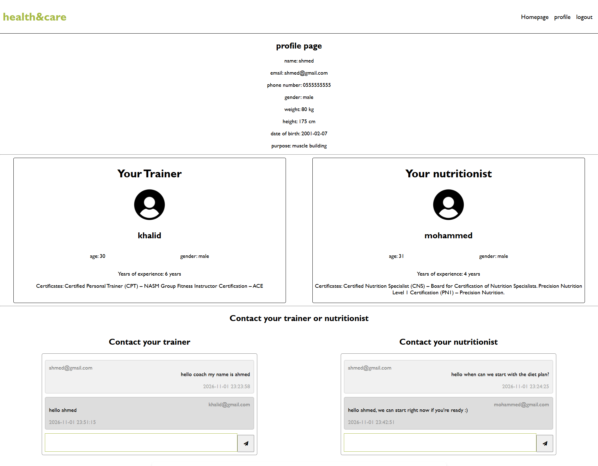
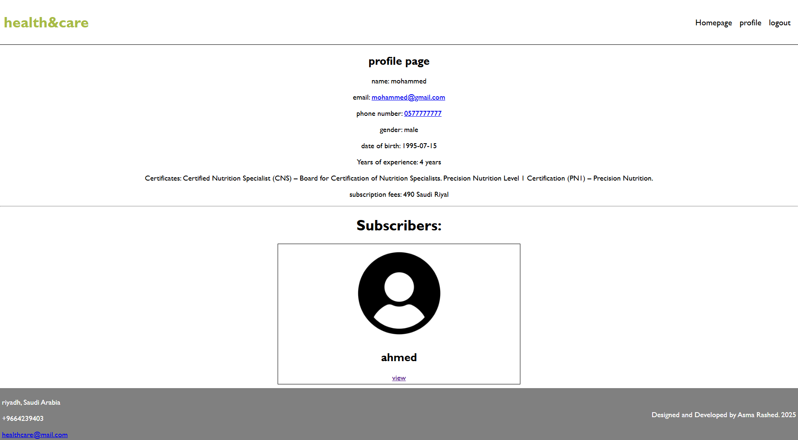
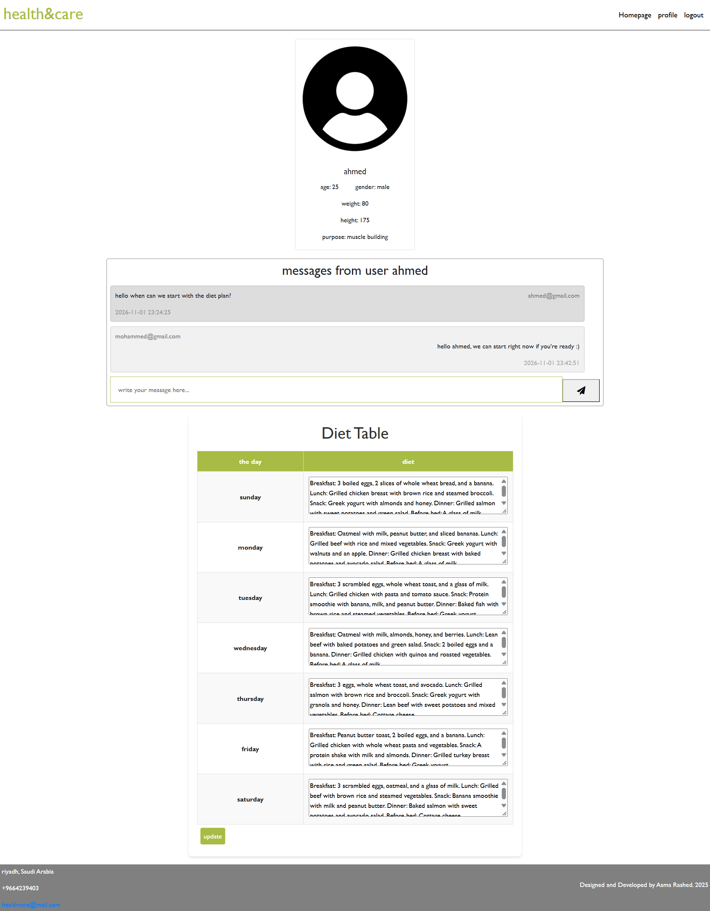

# Health & Care

A web platform that connects people who want to get fit with certified trainers and nutritionists. Users subscribe to a trainer and/or a nutritionist, chat with them, and receive a personal weekly exercise plan and diet plan.

Built with **PHP (mysqli), MySQL, HTML, CSS and JavaScript**.

## Features

**Users**
- Sign up with body data and a goal (weight, height, date of birth, purpose)
- Browse trainers and nutritionists, see their experience, certificates and fees, and subscribe
- Chat with their trainer and nutritionist
- View their weekly diet plan and weekly exercise plan

**Trainers and nutritionists**
- Sign up with experience, certificates and subscription fee
- See a list of their subscribers
- Chat with each subscriber
- Create and update a weekly exercise plan (trainer) or diet plan (nutritionist) for each subscriber

## Screenshots

### User profile
Personal data, the user's trainer and nutritionist, a chat with each, and the weekly plans.

### Nutritionist / trainer profile
Provider details and the list of subscribers.

### Managing a subscriber
Chat with a subscriber and create or update their plan.

## Security

- All database queries use **prepared statements** (protection against SQL injection)
- Output is escaped with `htmlspecialchars` (protection against XSS)
- Passwords are stored with `password_hash` (bcrypt)
- **CSRF tokens** on every POST form
- `session_regenerate_id` on login and sign-up (protection against session fixation)
- Role and ownership checks: a trainer or nutritionist can only open and edit subscribers who subscribed to them
- Database credentials are kept out of Git (`config.local.php` is in `.gitignore`)

## Run it locally (XAMPP)

1. Install [XAMPP](https://www.apachefriends.org/) and start **Apache** and **MySQL**.
2. Copy the `health` folder into `C:\xampp\htdocs\`.
3. Open phpMyAdmin (`http://localhost/phpmyadmin`), create a database called `health`, and import `health/health.sql`.
4. In the `health` folder, copy `config.local.example.php` to `config.local.php` and put your MySQL user and password in it. With a default XAMPP the user is `root` and the password is empty.
5. Open `http://localhost/health/`.

## Project structure

| File | Purpose |
| --- | --- |
| `config.php` | Database connection and shared helpers (escaping, CSRF, login checks) |
| `index.php` | Home page |
| `signin.php` / `login.php` / `logout.php` | Registration, login, logout |
| `profile.php` | Profile page for users, trainers and nutritionists |
| `viewcoaches.php` / `viewnutr.php` | Provider details and subscribe button |
| `viewuser.php` | Provider's view of a subscriber: chat and plan editor |
| `health.sql` | Database structure and sample data |

## Database

Eight tables: `users`, `coaches`, `nutritionists`, `coach_subscription`, `nutr_subscription`, `messages`, `exercises`, `diet`.

## Author

Asma Rashed, [github.com/asma-rashed](https://github.com/asma-rashed)
